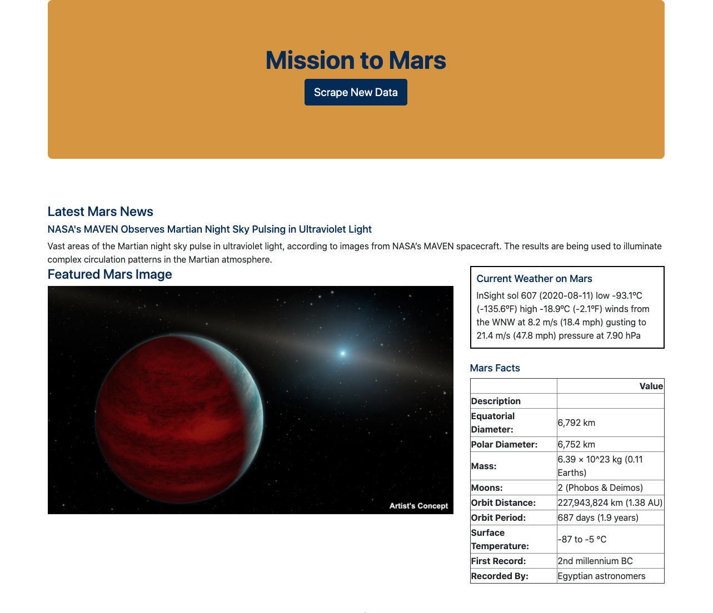
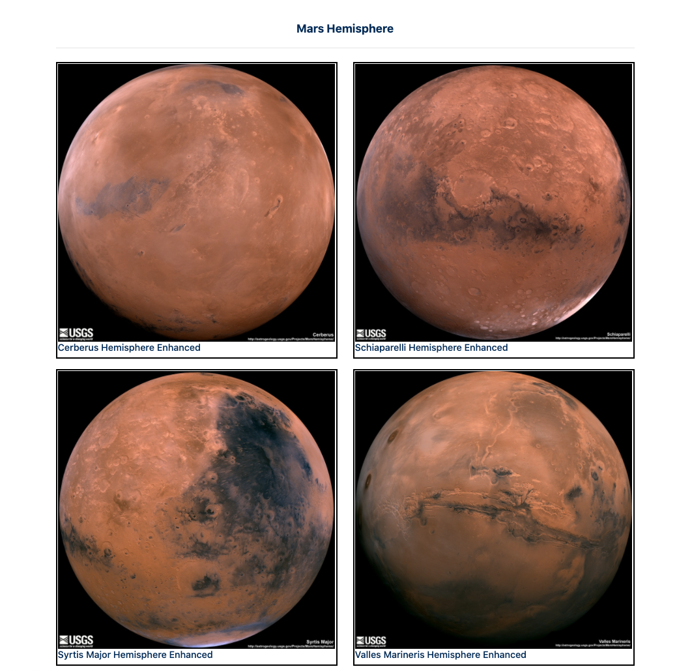

# Mission to Mars: Web Scraping App


A Flask web app that scrapes five Mars-related websites with **Splinter**, **BeautifulSoup** and **Pandas**, stores the results in **MongoDB**, and presents them on a single dashboard. A **Scrape New Data** button refreshes everything.


## What it collects

| Section | Source (2020) | Technique |
|---|---|---|
| Latest news headline and teaser | NASA Mars News | Splinter + BeautifulSoup |
| Featured full-size image | JPL Space Images | Splinter navigation |
| Current weather | `@MarsWxReport` on Twitter (InSight lander) | BeautifulSoup |
| Planet facts table | [space-facts.com/mars](https://space-facts.com/mars/) | `pandas.read_html` → HTML table |
| Full-resolution images of the 4 hemispheres | [USGS Astrogeology](https://astrogeology.usgs.gov/) | Splinter, following each result page |

## The app




| Route | Action |
|---|---|
| `/` | Reads the latest scrape from MongoDB and renders `templates/index.html` |
| `/scrape` | Runs `scrape_mars.scrape()`, saves the result to MongoDB (one document, replaced each time) and redirects to `/` |

## Project status

This project was built in 2020. Since then several of the source sites have **changed or shut down**: NASA redesigned its news site, JPL retired the Space Images page, and Twitter requires a login. The scraper handles this gracefully. Each section is scraped independently, so if a source fails, that section shows a placeholder and the others still load. As of November 2026, the **Mars facts** table still scrapes live.

The screenshots above show the app working against the original sites.

## Getting started

**Prerequisites:** Python 3.9+, Google Chrome and a running MongoDB (`brew services start mongodb-community` on macOS). Selenium downloads a matching ChromeDriver automatically, so you don't need to install one.

```bash
git clone https://github.com/ermiasgelaye/web-scraping-challenge.git
cd web-scraping-challenge/Missions_to_Mars
python -m venv .venv && source .venv/bin/activate
pip install -r requirements.txt

python app.py           # open http://127.0.0.1:5000 and click "Scrape New Data"
```

| Environment variable | Default | Purpose |
|---|---|---|
| `MONGO_URI` | `mongodb://localhost:27017/mars` | MongoDB connection string |
| `FLASK_DEBUG` | off | Set to `1` for debug mode and the auto-reloader |

You can also run the scraper on its own with `python scrape_mars.py`, which prints the scraped document.

## Project structure

```
web-scraping-challenge/
├── Missions_to_Mars/
│   ├── app.py                  # Flask routes
│   ├── scrape_mars.py          # scraping functions
│   ├── mission_to_mars.ipynb   # exploratory notebook the script was built from
│   ├── marsfacts.html          # sample output of the facts table
│   ├── requirements.txt
│   ├── templates/index.html    # Bootstrap dashboard
│   └── static/                 # header background image
└── Images/                     # README screenshots
```

## Author

**Ermias Gelaye** · [Portfolio](https://ermiasgelaye.github.io) · [GitHub](https://github.com/ermiasgelaye)
